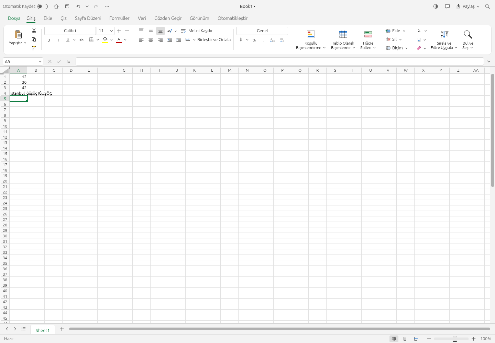
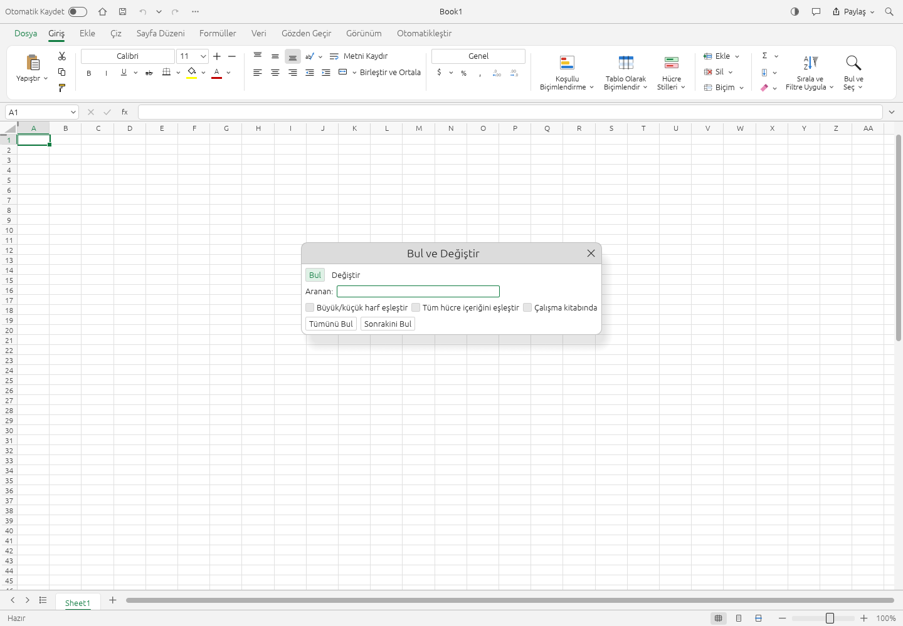
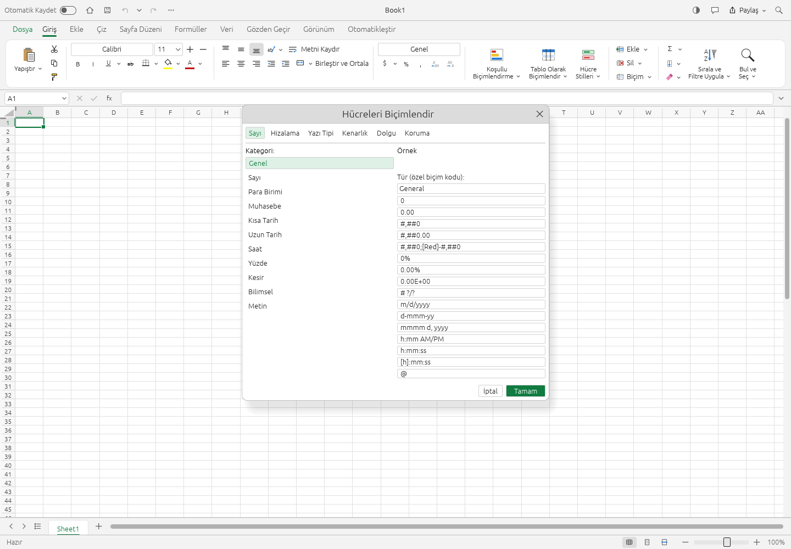

# Turkish interface

The Turkish catalog (`crates/ui-egui/src/i18n/tr.rs`) contains 1157 labels: the
shared ribbon catalog plus File view, dialog titles and fields, message boxes,
tooltips, sheet menus, chart and analysis tools, PivotTable fields, printer
controls and engine command labels. Untranslated text continues to fall back to
English. This covers all keys in the existing interface-language match catalogs,
including the Japanese and Portuguese dialog catalogs; the application also has
hardcoded strings outside those catalogs.

Select **View → Interface language → Türkçe**. On a first visit with no saved
language preference, a `tr-TR` browser/system language selects Turkish. A saved
choice takes precedence; the web app stores it in `gridcraft.ui` in localStorage.
Changing the interface language does not translate workbook contents, sheet names
or command identifiers.

## Function help and formula syntax

`i18n/tr_functions.rs` supplies 25 common function descriptions and 21 argument
names. The argument hint, autocomplete and Insert Function dialog use these
tables. A hint whose arguments are only partly translated stays entirely English,
following the shared help infrastructure.

Turkish currently uses the canonical English formula-entry syntax: `SUM(1.5,2.5)`,
with a decimal point and comma argument separator. This contribution does not add
Turkish function aliases or regional number/date formatting. Formula identifiers
and XLSX formulas remain English. Typed Turkish workbook text, including the
distinct letters `I`, `İ`, `ı` and `i`, is preserved rather than case-folded or
translated.

The shared dialog rendering now looks up previously hardcoded labels and formats
translated message templates without translating document titles or cell values.
The command palette displays translated command names and menu paths, and accepts
Turkish label searches as well as canonical English names and command identifiers.
Interface searches respect the dotted/dotless `I` distinction; canonical identifiers
retain their language-independent case folding.

## Validation

- The i18n tests require every shared and Japanese dialog key to have a nonempty
  Turkish translation with intact interpolation placeholders and no leaked
  `context|` prefix or unintended line break.
- Semantic samples cover save/discard, protect/unprotect, case-sensitive search,
  sheet deletion and context-dependent Fill.
- Function-help tests validate sorted, unique keys against the current function
  catalog. Turkish signature tests preserve function names, separators, optional
  argument brackets, argument indexes and workbook text.
- Rendered-dialog regressions exercise Turkish Find/Replace, save/discard, Format
  Cells and command search while checking canonical tab ids and unchanged data.
- Browser acceptance: first-run `tr-TR`, a saved manual language choice, File,
  Format Cells and Find/Replace dialogs, Turkish characters in cells, formula
  calculation and XLSX save/reopen. Check that labels remain readable at narrow
  widths and that a saved English preference still starts in English.

## Remaining localization work

Hardcoded labels outside the translation catalog, function help beyond these 25
descriptions, Turkish formula aliases and regional number/date formatting remain
separate work. PDF font/shaping limitations are unchanged; see
[localization parity](localization-parity.md).
